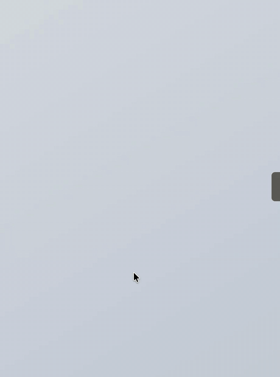
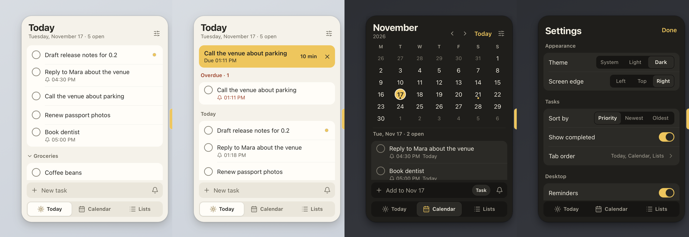
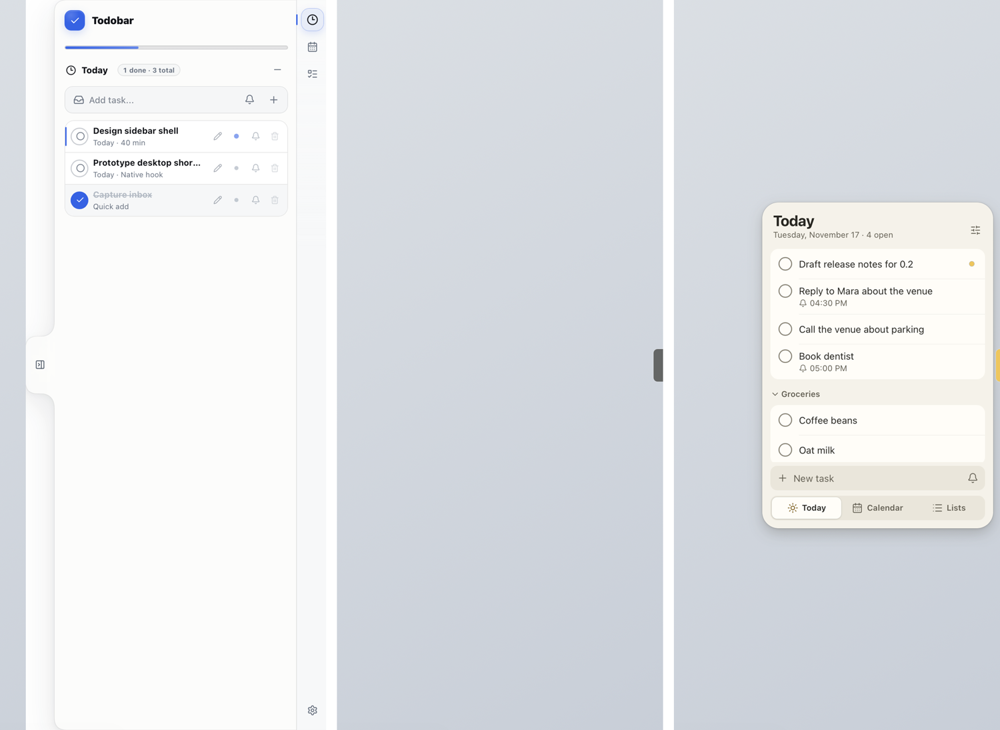

# Sidenib

[](https://github.com/AdiEngelbrecht/sidenib/actions/workflows/ci.yml)


Sidenib (side-nib) is a small task list that lives at the edge of your screen.
Closed, it is a 12 × 48 notch halfway down the right edge. Click it or pull it
inward and a rounded card comes out with Today, Calendar and Lists. It is a
desktop app for macOS and Windows, built with Tauri and React, and it keeps
everything on your machine.



The recording is the real macOS app, not a mock-up. A sharper
[MP4 of the same take](docs/media/sidenib-demo.mp4) is in the repository.

Sidenib is Adi Engelbrecht's independent remake of
[Todobar](https://github.com/Leonxlnx/todobar) by Leonxlnx: a personal
portfolio project, not affiliated with or endorsed by the Todobar project.
What was inherited and what is new is set out under
[What I changed](#what-i-changed) and
[Origin and attribution](#origin-and-attribution).

## Preview



Today, a reminder that came due while the card was open, Calendar and
Settings. All four are captures of the native macOS window.

### Before and after



Left: Todobar v0.1.14, the starting point, open on macOS. Middle and right:
Sidenib closed and open at the same place on the same screen.

## What it does

- **Notch and card.** Click the notch, pull it inward, or press the shortcut.
  A short pull springs back. Drag the notch along the edge to move it. The
  card is 340 × 480 and never grows; long content scrolls inside it.
- **Today.** Overdue tasks first, then open tasks, then one group for each
  list you pinned (each can be folded), then Completed.
- **Calendar.** A month grid (one week on short screens) with tasks and
  events on the selected day, capture onto that day, and arrow-key navigation.
- **Lists.** Your own lists, one at a time in detail. Pin a list to show it on
  Today.
- **Tasks.** Add, rename, complete, reopen, prioritise, schedule and delete.
  Row actions appear on hover or keyboard focus.
- **Reminders.** A due reminder shows as a small toast beside the closed
  notch, or as a banner inside the open card. It never opens the card or takes
  focus. Snooze for 10 minutes, open it, or dismiss it.
- **Settings.** System, Light or Dark; left, top or right edge; sort order;
  tab order; launch at login. Sizes, density, theme presets and a backdrop
  image are under Advanced.
- **Desktop.** Native tray/menu-bar control for open, Settings and quit; a
  global shortcut; one running instance; click-through everywhere outside the
  notch and the card.

Tasks and settings are stored locally in the app's web view storage. There is
no account, no sync and no analytics.

## Status

Current version: `v0.2.0` (not released; no tag or published installer yet).

| Platform | Status |
| --- | --- |
| macOS, Apple Silicon | Built and exercised natively on macOS 26. The app is ad-hoc signed only: not signed with a Developer ID and not notarized. |
| macOS, Intel | Compiled by CI. Not run. |
| Windows | Compiled and smoke-tested in a browser by CI. The remake has not been run on a Windows machine; pointer pass-through there uses polling, and focus return is not implemented. |
| Android | The inherited companion app with the Sidenib name. It is outside this redesign and still has the upstream layout. |

What was and was not checked for this version, including the limits of the
native pass, is in
[Release verification v0.2.0](docs/release-verification-v0.2.0.md).
[Release notes v0.2.0](docs/release-notes-v0.2.0.md) lists the changes and
known issues.

## Install

There is no download yet. Build the app from source; on a Mac that takes a
few minutes.

Requirements:

- Node.js 22 or newer, with npm
- Rust stable 1.77.2 or newer, installed with [rustup](https://rustup.rs)
- The [Tauri v2 prerequisites](https://v2.tauri.app/start/prerequisites/):
  Xcode Command Line Tools on macOS (`xcode-select --install`); Microsoft C++
  Build Tools and WebView2 on Windows

```bash
git clone https://github.com/AdiEngelbrecht/sidenib.git
cd sidenib
npm ci
npm run tauri:build
```

On macOS this writes:

- `src-tauri/target/release/bundle/macos/Sidenib.app`
- `src-tauri/target/release/bundle/dmg/Sidenib_0.2.0_aarch64.dmg`

Open the `.dmg` and drag Sidenib to Applications, or run the `.app` where it
is. A build made on your own Mac opens normally. A copy downloaded from
somewhere else is quarantined by macOS and, because the app is not notarized,
has to be allowed once under System Settings → Privacy & Security.

On Windows the same command writes `.exe` and `.msi` installers under
`src-tauri\target\release\bundle\`.

Sidenib installs as its own app (`io.github.adiengelbrecht.sidenib`) and runs
beside an installed Todobar. It starts with its own empty data and does not
read or migrate Todobar's tasks or settings; see
[Sidenib identity](docs/sidenib-identity.md).

Launch at login is on by default. Turn it off in Settings if you are only
trying a build from a folder you will delete.

## Use

| Action | How |
| --- | --- |
| Open or close | Click the notch, or press `Option + Shift + S` on macOS, `Alt + Shift + S` on Windows |
| If that shortcut is taken | `Control + Option + Shift + S`, or `Ctrl + Alt + Shift + S`. The tray/menu-bar menu shows which one is active. |
| Pull open | Drag the notch inward about 50 px |
| Move the notch | Drag it along the edge; it snaps to the middle |
| Close | `Esc`, the notch, the shortcut, or the menu-bar item |
| Change tab | The tabs at the foot of the card; left and right arrows work there |
| Add a task | Type in the field at the bottom and press `Enter` |
| Settings | The sliders button in the header, or the menu-bar item |

`Esc` peels one layer at a time: a menu, a rename, an unsent draft, Settings,
then the card.

## What I changed

Todobar v0.1.14 is a full-height sidebar. Sidenib keeps its task model and
its desktop plumbing and replaces the shell, the views and the identity.

**Mine, in this repository**

- The name, the Peek icon and menu-bar mark, and a separate app identifier,
  storage namespace, keychain service and login item, so both apps can be
  installed together ([identity](docs/sidenib-identity.md),
  [brand](docs/brand-direction.md)).
- The compact shell: one geometry module that places the notch, card and
  toast; a native window that is only as large as what is drawn; and pointer
  pass-through for the shadow, the rounded corners and the gap at the screen
  edge, event-driven on macOS ([shell](docs/shell.md)).
- Click, pull and drag-to-move on the notch, with focus going to the right
  place on open and back to the previous app on close.
- The views, rewritten from a 3,656-line `App.tsx` into a small composition
  root, shared components and one module per view, in a Notes-like style built
  on design tokens ([views](docs/views.md)).
- The Calendar's day states, week mode and keyboard navigation
  ([calendar](docs/calendar.md)), and Settings as a short page with Advanced
  behind it and a System theme ([settings](docs/settings.md)).
- The in-card reminder banner, foldable pinned lists, and the browser tests
  for all of the above.
- The written [design contract](docs/design/compact/README.md) the work was
  built against.

**Inherited from Todobar**

- The Tauri v2 and React project, build scripts and CI and release workflows.
- The task, list and reminder model and local storage.
- Tray, global shortcut, autostart and single-instance wiring.
- The theme presets and backdrop image options, now under Advanced.
- The Android companion.
- A read-only Gmail connector that is present in the code and hidden in the
  app. No OAuth client is configured for Sidenib.

## Architecture

```text
src/
  App.tsx            composition: shell, data hooks, one view at a time
  shell/             notch, card frame, geometry, gestures, native window bridge
  components/        PanelView, TaskRow, Group, QuickAdd, Popover, controls
  views/             today, lists, calendar, settings
  data/taskStore.ts  tasks and lists, every mutation, storage
  reminders/         the due check, the toast and the banner
  design/            tokens and theme presets
src-tauri/src/
  lib.rs             tray, global shortcut, plugins
  shell.rs           window frame, pointer pass-through, focus return
tests/               Playwright specs for the shell and each view
```

- React 19 and TypeScript for the interface, Tauri v2 and Rust for the window.
- The frontend computes the layout from the monitor's work area and sends the
  native side the window bounds and the regions that take the pointer in one
  call. Only the notch, the card and the toast take the pointer.
- Views read design tokens (`--sn-*`) and never read window size or settings
  directly.
- The web view is transparent through Tauri's `macOSPrivateApi`, which rules
  out the Mac App Store.

The [documentation index](docs/index.md) lists the rest, including the
upstream planning notes such as the [Product vision](docs/product-vision.md),
which describe Todobar's roadmap and are kept as history.

## Development

```bash
npm ci
npm run dev          # browser preview at http://127.0.0.1:5173
npm run tauri:dev    # the native app with hot reload
```

Checks:

```bash
npm run verify       # versions, links, identity and attribution
npm run lint
npm run build
npm run test:smoke   # Playwright; run `npx playwright install chromium` once
node docs/design/compact/geometry.js --check
cargo test --manifest-path src-tauri/Cargo.toml
npm run test:native  # release build without bundling
```

CI runs these on Windows and macOS for pull requests to `main`. Pushing a
version tag runs `release.yml`, which builds installers for Windows, macOS
Apple Silicon and macOS Intel; `android.yml` builds the APK. No tag has been
pushed for Sidenib.

`npm run icons` regenerates the native icon set from the artwork in
`docs/design/sidenib/`.

## Origin and attribution

| | |
| --- | --- |
| Upstream project | [Leonxlnx/todobar](https://github.com/Leonxlnx/todobar) |
| Upstream baseline release | `v0.1.14` (tag commit `12a49c9`) |
| Starting source commit | `809b0d5857b03b3fec946f227ddaffb70cbe2789` (upstream `main`, three commits after `v0.1.14`) |
| License | Apache License 2.0, unchanged |

The full upstream Git history is preserved in this repository. The original
copyright line stays in [`LICENSE`](LICENSE), and [`NOTICE`](NOTICE) records
what Sidenib changed. Documents under [`docs/`](docs/) that predate the
remake, including the `release-verification-v0.1.*` records and the entries
for `0.1.14` and earlier in the [changelog](CHANGELOG.md), describe upstream
Todobar and keep its name.

## License

Apache License 2.0. See [`LICENSE`](LICENSE) and [`NOTICE`](NOTICE).
