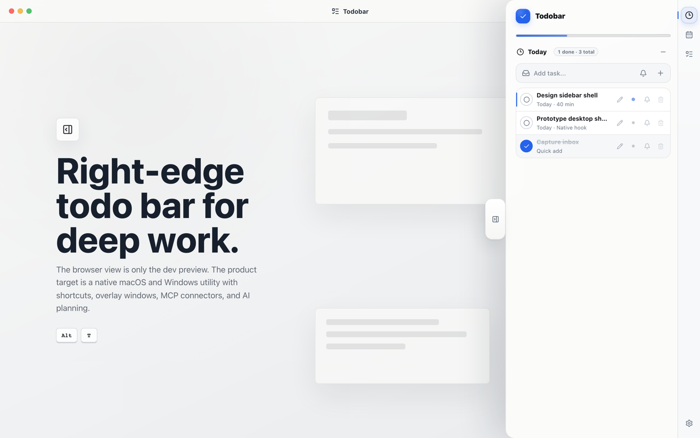
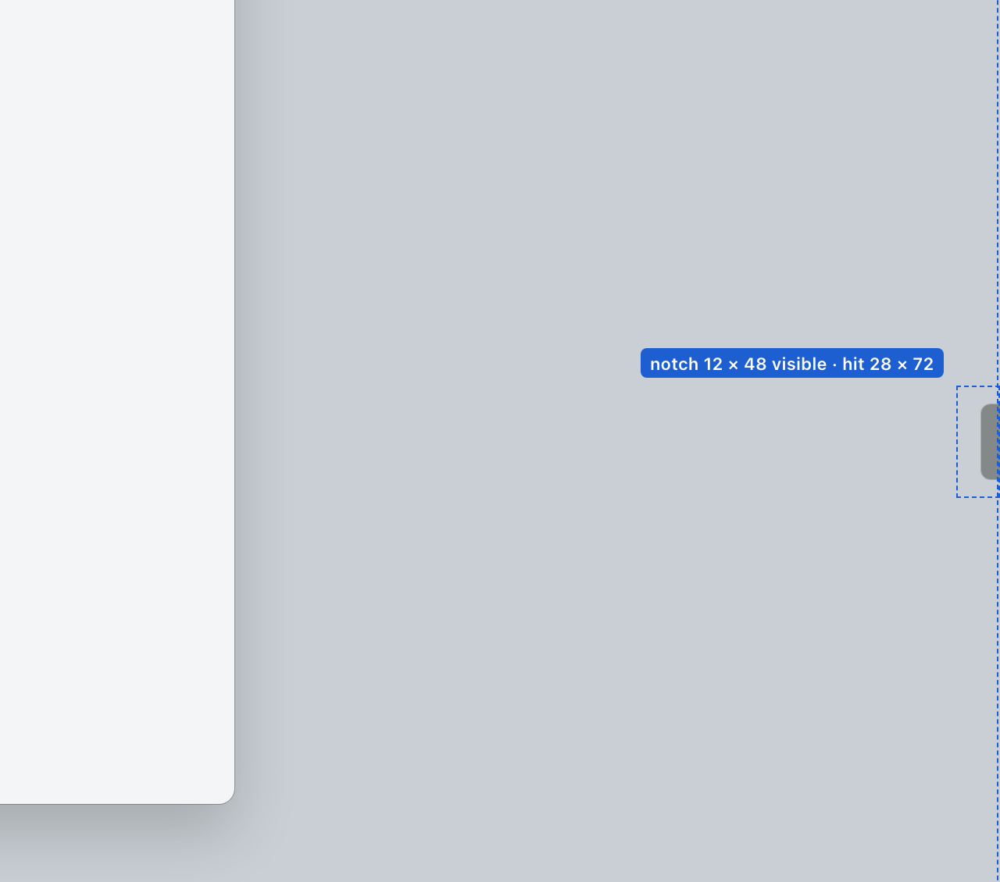
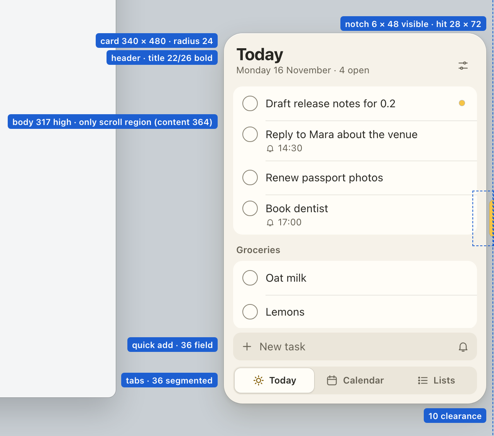
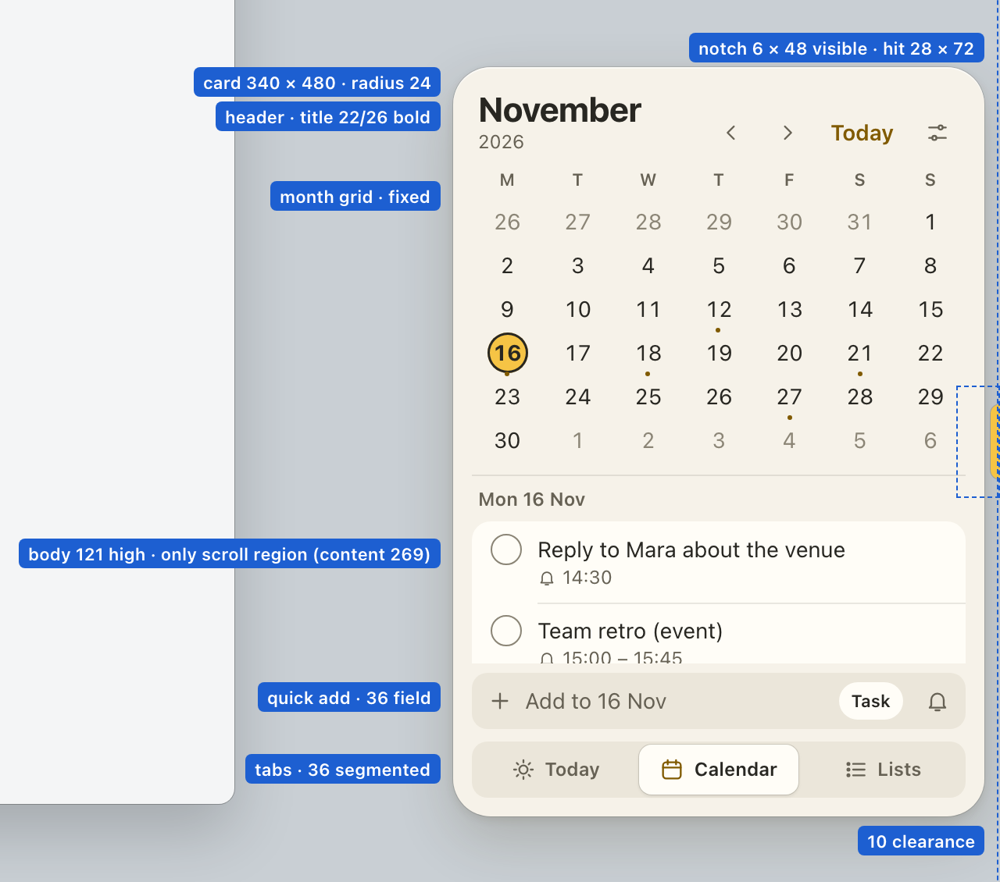
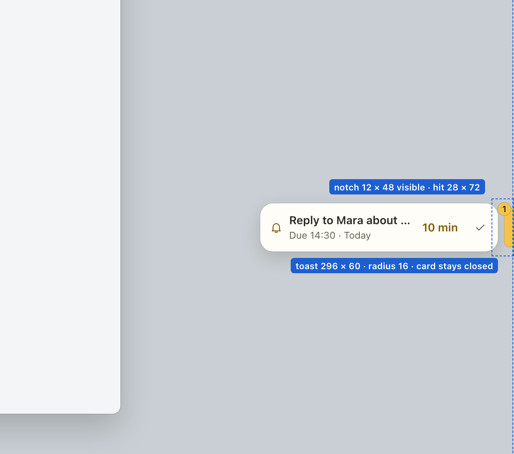

# Sidenib compact design contract

Task ADIEN-159. This is the single visual and interaction specification for the
compact Sidenib shell. Every later workspace (shell, Today and Lists, Calendar,
Settings, reminders) builds to this document. Nothing here changes production
code: `src/`, `src-tauri/` and the Sidenib brand assets are untouched.

Sidenib is a task utility. Apple's iPhone Notes guides how it looks. It does
not gain a rich-text notes feature.

## What is in this folder

| File | Purpose |
| --- | --- |
| [tokens.css](tokens.css) | Light and dark design tokens. Copied unchanged to `src/design/tokens.css`. |
| [geometry.js](geometry.js) | Reference placement and gesture rules, with a self-check. Ported to `src/shell/geometry.ts`. |
| [prototype.html](prototype.html) | Static, clickable prototype of every state. Open it in a browser; no server or build needed. |
| [prototype.css](prototype.css), [prototype.js](prototype.js) | Prototype styles and behaviour. Classes prefixed `sn-` are the product surface; `proto-` is review chrome. |
| [capture-frames.mjs](capture-frames.mjs) | Regenerates [frames/](frames/) and runs the browser checks listed under Verification. |
| [frames/](frames/) | 27 reference frames, most annotated, plus measured [metrics.json](frames/metrics.json). |
| [baseline/](baseline/) | Screenshots of the v0.1.14 baseline used for the audit. |

If this document and the prototype disagree, this document wins and the
prototype is a bug.

## 1. Baseline audit: why v0.1.14 feels large and rectangular

Measured in the v0.1.14 web preview at 1440 × 900 and 1280 × 600 logical pixels,
and read from `src/App.tsx`, `src/App.css`, `src/sidebarSettings.ts` and
`src-tauri/src/lib.rs`.



| Finding | Baseline value | Effect |
| --- | --- | --- |
| The panel is as tall as the screen | 400 wide × 100% of the work area (`targetHeight = workArea.size.height`) | Three tasks occupy a 900-high column. Most of the surface is empty, and it reads as a docked sidebar. |
| The panel is flush with three screen edges | Top, right and bottom offsets are 0; only the two left corners show the 18 radius | The shape is a rectangle with a rounded side. No corner radius can make a full-height strip feel like a card. |
| A second full-height strip | Navigation rail 46 × 900 inside the panel | Adds a second vertical band and a hard internal line. |
| The closed handle is a visible button | 42 × 84 with an icon and shadow | Always-present chrome on the desktop, roughly 3.5 times the width the brief asks for. |
| Nested boxes | Bordered quick-add box, bordered task group, bordered calendar board, bordered day summary pills, bordered Task/Event switch | Five box styles on one screen. Separators are doing the work that spacing should do. |
| Small, heavy type | Task title 12.5 px at weight 680; Inter is requested but not bundled, so it falls back | Dense and loud at the same time. Not a system-native reading size. |
| Action icons always visible | Four icons on every row: edit, priority, reminder, delete | A three-row list shows twelve controls before the user has asked for one. |
| Cool blue on cool grey | Accent near `#2563EB`, surfaces `#F5F6F7` to `#FFFFFF` | Unrelated to the Sidenib paper, gold and ink identity. |
| The calendar does not fit a short display | At 1280 × 600 the month, day summary and entry switch push the add field to the bottom edge; the agenda is below the fold | The view only works because the panel is full height. |
| Settings open on a control panel | 9 theme presets and 13 sliders for width, radius, opacity, row height, text size, motion and backdrop, all on the first screen | The everyday switches are buried among tuning controls, and the page scrolls well past two screens. The controls are worth keeping; their place is one level down. |
| A full-height transparent native window | 442 wide × screen height, with cursor pass-through polled every 72 to 128 ms | The window covers a screen-high strip of other apps even when three tasks are shown. Smaller bounds reduce what has to be passed through; they do not remove the need for hit testing (section 3). |

Other baseline screens: [closed](baseline/v0.1.14-laptop-closed.png),
[calendar](baseline/v0.1.14-laptop-calendar.png),
[lists](baseline/v0.1.14-laptop-lists.png),
[settings](baseline/v0.1.14-laptop-settings.png),
[calendar at 600 high](baseline/v0.1.14-short-calendar.png).

### What stays from the baseline

Local-first storage, the `Task` model, Today, Calendar with task and event
entries, custom lists with "show on Today", inline reminders with snooze, the
focus/normal/later priority, sort order, tab order, launch at login, the tray
menu, a global shortcut with a fallback (`Alt+Shift+S` and
`Ctrl+Alt+Shift+S` in Sidenib; the baseline used `Alt+T`), dragging the handle along the
edge, and reminders that never open the panel by themselves.

Every supported preference also stays: the right, left and top dock edges, the
nine theme presets, the backdrop image, the size, density, opacity and motion
controls, and the hover-only handle. This contract changes their defaults to
the compact right-middle Sidenib look and moves the tuning controls to an
Advanced page (section 5). No stored preference is deleted or converted.

## 2. iPhone Notes reference

The reference is the first-party Notes app on iPhone, together with Apple's
published guidance on
[typography](https://developer.apple.com/design/human-interface-guidelines/typography),
[colour](https://developer.apple.com/design/human-interface-guidelines/color) and
[lists and tables](https://developer.apple.com/design/human-interface-guidelines/lists-and-tables).
The traits below are observations of the app, not pixel samples, and no Apple
screenshots or artwork are stored in this repository. Sidenib borrows the
language, not the assets.

| Trait | iPhone Notes | v0.1.14 | Sidenib compact |
| --- | --- | --- | --- |
| Typography | System font. One large bold title per screen, regular-weight body, small grey secondary line. | 12.5 px at weight 680 for content; several competing bold labels. | System font. One 22 px bold title per view, 14 px regular body, 12 px secondary line. |
| Surfaces | A warm off-white grouped background with lighter rounded groups on top. Depth comes from two tones, not borders. | White and cool grey, separated by 1 px borders. | Paper `#F6F2E9` card, lighter `#FFFDF7` groups, darker `#EBE6DA` fields. No bordered boxes. |
| Accent | Yellow-gold for the things you can act on and for filled checklist circles. Everything else is ink or grey. | Blue on buttons, checks, progress bar, active rail item and focus. | Gold `#F6C445` only as a fill: today, checked circle, switch, reminder, open notch. Dark amber `#805A00` where gold must be text. |
| Spacing | Generous outer margins, compact rows of about 44 pt. | 20 px margins but 48 px rows packed with icons. | 12 to 16 px margins, 44 px rows, actions hidden until hover or focus. |
| Separators | Hairlines inset to the text edge, never full width, never boxed. | Full-width borders around and between everything. | 0.5 px hairline at 10% ink, inset to the text edge. |
| Checklists | Outlined circle; filled gold with a check when done; done text dims. | Blue filled circle; done text struck through. | Same as Notes. Done text dims to secondary ink, no strike-through. |
| Navigation | A back chevron with the parent's name, in gold. | Icon rail. | Three-segment control at the bottom; a gold back label inside Lists. |

## 3. Geometry

All values are logical pixels. [geometry.js](geometry.js) is the reference
implementation; `node docs/design/compact/geometry.js --check` proves the rules
on seventeen work-area and preference combinations.



| Element | Value | Brief range | Reason |
| --- | --- | --- | --- |
| Notch, visible | 12 × 48, inner corners radius 6, flush with the screen edge | 10–14 × 44–52 | Mid-range. 12 is the narrowest width that still shows a rounded end at 1×. |
| Notch, hover or pulling | 14 × 48 | within range | Confirms the pointer is on it without opening anything. |
| Notch, card open | 6 × 48, gold | revised | It must fit inside the 10 clearance beside the card and still read as the close control. |
| Notch hit target | 28 × 72, centred on the notch, extends inward only | "practical hit target" | 28 wide is reachable when the pointer is thrown at the screen edge (the edge itself is infinitely deep). 72 high tolerates vertical error. It covers 28 × 72 of the desktop, which is less than the baseline's visible 42 × 84 handle. |
| Default notch position | 50% of the work-area height | 50% | As briefed. Within ±3% of centre it snaps to 50%. |
| Open card | 340 × 480 | about 340 × 480 | As briefed. |
| Card radius | 24 | 22–26 | Mid-range. Groups inside use 12 and controls 10, so every nested radius is half or less of its parent. |
| Edge clearance | 10 on every side | 8–12 | Mid-range. It is what makes the card a card: all four corners are visible. |
| Reminder toast | 296 × 60, radius 16, 8 from the notch | not briefed | Wide enough for a 20-character title plus two actions. |

### Sizing inside the work area

The work area is the monitor minus the menu bar, Dock or taskbar
(`monitor.workArea` in Tauri).

```text
cardWidth  = min(340, workArea.width  − 2 × 10)
cardHeight = min(480, workArea.height − 2 × 10)
cardX      = workArea.right − 10 − cardWidth          (right edge)
cardY      = clamp(notchCentreY − cardHeight / 2,
                   workArea.top + 10,
                   workArea.bottom − 10 − cardHeight)
```

- The card is centred on the notch, then pushed back inside the work area. A
  notch dragged to the top or bottom never produces a clipped card.
- The card height never depends on content. A list of 500 tasks produces the
  same 340 × 480 card as an empty one.
- Below 420 card height the Calendar shows one week instead of the month. This
  applies to work areas shorter than 440, which no supported laptop has, but
  it keeps the rule total.
- A work area shorter than 340 is not supported; the card still clamps and
  scrolls.

| Work area | Card | Notes |
| --- | --- | --- |
| 1440 × 875 (13-inch MacBook, Dock hidden) | 340 × 480 | [frame](frames/19-fit-laptop.png) |
| 1280 × 575 (short display) | 340 × 480 | [frame](frames/20-fit-short.png); 47 px spare above and below |
| 1366 × 728 (Windows laptop) | 340 × 480 | self-check |
| 1024 × 420 (very short) | 340 × 400, week-strip calendar | [calendar](frames/21-fit-tiny.png), [long list](frames/22-fit-tiny-long.png) |

### Dock edges

Right is the default. Left mirrors it. Top is retained from the baseline: the
notch lies along the top edge (48 long, 12 deep), `handleY` positions it along
the width, and the same card drops down from it with 10 clearance, centred on
the notch and clamped inside the work area. Pulling down opens it; dragging
sideways repositions it. [top edge](frames/23-top-edge.png),
[top edge toast](frames/24-top-edge-toast.png),
[left edge](frames/18-left-edge.png).

The baseline's top panel was about twice as wide and laid its sections side by
side. The compact card uses tabs instead, so the top edge shows the same card
as the sides. A user who wants the wider top panel raises Width in Advanced.

### Advanced sizes

The numbers above are defaults, not limits on the user. The Advanced page
(section 5) keeps the baseline's size preferences. `computeGeometry` accepts
them as options and clamps them, so a stored value can never place the card
outside the work area or shrink the notch below a usable target.

| Preference (`SidebarSettings`) | Compact default | Safe bounds | Applied as |
| --- | --- | --- | --- |
| `panelWidth` | 340 | 320–560, then at most work-area width − 20 | card width |
| `panelHeightMode` (new) | `'compact'` | `'compact'` or `'full'` | 480, or work-area height − 20 |
| `tabWidth` | 12 | 10–112 | visible notch thickness; the hit target is at least 28 |
| `handleHeight` | 48 | 44–176 | visible notch length; the hit target is at least 72 |
| `handleY` | 50 | 0–100 | notch centre along the edge |
| `panelRadius` | 24 | 12–28 | `--sn-radius-card` |

Upper bounds equal v0.1.14's, so every stored value remains valid. Lower
bounds for `tabWidth` and `handleHeight` are widened from 22 and 56 to admit
the compact defaults. Clamping happens when a value is applied; the stored
preference is not rewritten. Full height is the baseline's full-height layout
inside the card frame: it keeps the radius, the 10 clearance and the internal
scroll. It is opt-in and never a default.
[560 wide, full height](frames/26-advanced-wide-full.png),
[the same on a short display](frames/27-advanced-wide-short.png).

### Native window and pointer pass-through

`computeGeometry` returns suggested window bounds for each mode: the hit target
when collapsed, hit target plus toast, and hit target plus card, the last two
with a 28 px margin for the shadow (378 × 536 open at default size). The 16 px
reveal travel fits inside that margin, so the card can animate inside a window
that has already reached its final bounds.

Smaller bounds only reduce the area in question. They do not make anything
click-through: the shadow margin, the four rounded corners and the gap beside
the open notch are transparent pixels inside the window, and a native window
intercepts the pointer there unless the shell does something about it.

The acceptance invariant for the shell workspace:

- Pointer events are intercepted only over the visible notch hit target, the
  visible card and the visible toast. `computeGeometry(...).interactive` lists
  these rectangles per mode; the card and toast rectangles are rounded by their
  radius.
- Every other pixel inside the window bounds passes clicks, hovers, scrolls and
  drags to whatever is underneath: the shadow margin, the area outside each
  rounded corner, and the clearance gap.
- This holds when collapsed, with a toast, when open, during the reveal and
  dismiss transitions, on each dock edge, at 1× and 2× scale, and on a second
  monitor.

How it is achieved is the shell workspace's choice, and it must be a mechanism
the platform and Tauri actually support, verified natively on macOS and
Windows. Candidates include a native hit-test or window-region shape, and
toggling `setIgnoreCursorEvents` from pointer position as the baseline does. If
no event-driven approach is available on a platform, a polling fallback is
acceptable when it is bounded: it runs only while the pointer is near the
window, at a stated interval no shorter than the baseline's 72 ms, and stops
when the pointer leaves. The browser checks in this folder cover layout only.
They prove nothing about native pass-through.

## 4. Card anatomy



Top to bottom at 340 × 480:

| Region | Height | Content |
| --- | --- | --- |
| Header | 65 with a secondary line, 56 without | View title (22/26 bold), one secondary line, up to three trailing actions of 28 × 28. Settings is always the last action. |
| Fixed area | 0, or 197 in Calendar | Weekday labels, six 28 px week rows and a hairline. Does not scroll. |
| Body | the remainder: 317 in Today | The only scrolling region. `overflow-y: auto`, `overscroll-behavior: contain`. A hairline appears under the header once scrolled. |
| Quick add | 48 (36 field) | Present in Today, Calendar and list detail. Absent in the Lists index and Settings. |
| Tabs | 50 (36 control) | One segmented control: Today, Calendar, Lists, in the user's tab order. |

Rules:

- Exactly two surface levels inside the card: the card and one group. No group
  inside a group, no bordered boxes.
- One group style, one field style, one segmented style, one switch, one icon
  button, one text button. Views do not introduce variants.
- A task row is 44 high with one line, 52 with a reminder line. The title wraps
  to two lines and then truncates with an ellipsis; an unbroken token wraps
  instead of overflowing.
- Row actions (reminder, more) appear on hover and on keyboard focus, laid over
  the row's trailing edge so nothing shifts. "More" holds rename, priority and
  delete. Delete asks for confirmation as it does today.
- The focus priority shows as a 7 px gold dot at the trailing edge. Normal and
  later show nothing.
- Icons are `lucide-react` (already a dependency) at 16 px with 1.75 stroke.
  No emoji, no second icon set.
- The brand name does not appear inside the card. The title is the view name.
  The Peek mark is for the app icon and the menu bar only.

## 5. States

### Collapsed

[frame](frames/01-collapsed.png). Only the 12 × 48 notch is drawn. Colour is ink
at 42% opacity in light, paper at 50% in dark. It carries no icon and no label.
With an unread reminder it turns gold and shows a 16 px count badge.

### Today

| State | Frame | Specification |
| --- | --- | --- |
| Populated | [02](frames/02-today-populated.png) | Subtitle "Monday 16 November · 4 open". One group of open tasks, then one labelled group per list pinned to Today, then a collapsed "Completed · n" disclosure. |
| Empty | [03](frames/03-today-empty.png) | Centred in the body: "Nothing for today" (15/20 semibold) and one line naming the two ways to add a task. No illustration. Quick add stays in place. |
| Long title | [04](frames/04-today-long.png) | Two-line clamp, then ellipsis. The full title is available through rename and as a tooltip. |
| Long list | [04](frames/04-today-long.png), [scrolled](frames/05-today-long-scrolled.png) | 18 tasks give 903 px of content in a 317 px body. The card stays 480 high. Header, quick add and tabs stay fixed. |
| Overdue | [06](frames/06-today-overdue.png) | An "Overdue · n" group first, label and due line in the danger colour, title in normal ink. Oldest first. The Today group follows under its own label. |
| Completed | [07](frames/07-today-completed.png) | Checked circle filled gold, title in secondary ink. When everything is done: "All done" and the Completed group expanded. Hidden entirely when "Show completed" is off. |

### Calendar



- Title is the month, secondary line is the year. Trailing actions: previous,
  next, "Today", settings.
- Month grid: 7 columns, weeks start on Monday, 28 px rows, single-letter
  weekday labels. The grid is fixed; only the agenda below it scrolls.
- Today is a gold filled circle with ink text. The selected day has a 1.5 px
  ink ring. A day with entries has a 3 px dot below the number; red when any
  entry is overdue. Days outside the month are tertiary ink.
- Agenda: the selected day's label, then one group of tasks and events sorted
  by time. Events are ordinary rows whose secondary line is a time range. At
  480 high a six-week month leaves about 121 px, which is two rows and a visible
  part of the third; a five-week month leaves 149 px. This is the tightest
  budget in the design and is accepted because the card must not grow.
- Quick add reads "Add to 16 Nov". A chip inside the field switches between
  Task and Event, replacing the baseline's full-width switch.
- Unscheduled tasks ("backlog" in the baseline) follow the agenda in the same
  scrolling body under their own label.
- Card height below 420: the grid shows only the week containing the selected
  day. Previous and next move by week. [frame](frames/21-fit-tiny.png)

### Lists

- Index, [frame](frames/09-lists.png): one group, one row per list with its
  open count and a chevron. Trailing header action "New list". No quick add.
- Detail, [frame](frames/10-list-detail.png): gold "‹ Lists" back label above
  the list title. Secondary line shows the open count and "shown on Today" when
  pinned. The header's "more" action holds rename, show on Today and delete.
  Quick add reads "New task in Groceries".

### Settings

[light](frames/11-settings.png) is the same layout as
[dark](frames/16-dark-settings.png). Settings is a view inside the card, not a
drawer and not a window. It is opened from the header action or the tray menu;
"Done" returns to the previous view.

The default page is short: ten rows, no sliders.

| Group | Row | Control |
| --- | --- | --- |
| Appearance | Theme | System, Light, Dark |
| Appearance | Screen edge | Left, Top, Right |
| Tasks | Sort by | Priority, Newest, Oldest |
| Tasks | Show completed | switch |
| Tasks | Tab order | pushes a three-row reorder list |
| Desktop | Reminders | switch |
| Desktop | Launch at login | switch |
| Desktop | Open or close | shows the shortcut, read-only |
| More | Advanced | pushes the Advanced page |
| More | Reset settings | danger text, confirms first; restores the compact defaults |

The Advanced page, [frame](frames/25-settings-advanced.png), holds every tuning
control the baseline has. It uses the same grouped rows, with a gold
"‹ Settings" back label.

| Group | Row | Control | Field |
| --- | --- | --- | --- |
| Panel | Height | Compact, Full | `panelHeightMode` |
| Panel | Width | slider 320–560 | `panelWidth` |
| Panel | Corner radius | slider 12–28 | `panelRadius` |
| Panel | Surface opacity | slider 58–100% | `surfaceAlpha` |
| Notch | Show | Always, On hover | `tabVisibility` |
| Notch | Thickness | slider 10–112 | `tabWidth` |
| Notch | Length | slider 44–176 | `handleHeight` |
| Density | Row height | slider 40–62 | `taskRowHeight` |
| Density | Row spacing | slider 0–14 | `taskGap` |
| Density | Text size | slider 11–14 | `taskTextSize` |
| Density | Motion | slider 140–360 ms | `motionMs` |
| Look | Theme preset | pushes a list: Sidenib plus the nine baseline presets for the current mode | `visualStyle` |
| Look | Backdrop image | pushes upload, clear, opacity, blur and dim | `backdropImage`, `backdropImageName`, `backdropOpacity`, `backdropBlur`, `backdropDim` |

The prototype shows Row spacing and the two pushed pages as rows only.

How `SidebarSettings` changes. No field is removed.

| Field | Change | Compact default (was) |
| --- | --- | --- |
| `dockEdge` | unchanged: `'right' \| 'left' \| 'top'`; a stored `'bottom'` still becomes `'top'` as it does today | `'right'` |
| `panelWidth` | default only | 340 (400) |
| `panelHeightMode` | new: `'compact' \| 'full'`; absent in stored settings means `'compact'` | `'compact'` |
| `tabWidth` | lower bound 10 (22), default | 12 (42) |
| `handleHeight` | lower bound 44 (56), default | 48 (84) |
| `handleY` | unchanged | 50 |
| `panelRadius` | default only | 24 (18) |
| `surfaceAlpha` | default only | 100 (96) |
| `taskRowHeight` | unchanged | 44 |
| `taskGap` | lower bound 0 (4), default; 0 gives the hairline-separated group | 0 (7) |
| `taskTextSize` | default only | 14 (12.5) |
| `motionMs` | default only | 220 (230) |
| `tabVisibility` | unchanged: `'always' \| 'hover'` | `'always'` |
| `theme` | extended: `'system' \| 'light' \| 'dark'` | `'system'` (`'light'`) |
| `visualStyle` | extended: `'sidenib'` added to both modes and made the default; the nine presets stay | `'sidenib'` (`'codex'`) |
| `backdropImage`, `backdropImageName`, `backdropOpacity`, `backdropBlur`, `backdropDim` | unchanged | no image |
| `showCompleted`, `launchAtLogin`, `notificationsEnabled`, `taskSortMode`, `sectionOrder` | unchanged | unchanged |

Rules for the Settings workspace:

- Stored preferences are kept. The sanitiser continues to clamp each field to
  its bounds and nothing else; it does not reset a field because its value
  differs from the compact default. Whether settings stored under the Todobar
  key are imported into Sidenib's own key belongs to the identity work; if they
  are, they are imported as they stand.
- New defaults apply to a fresh install and to "Reset settings".
- Advanced values reach components only as token overrides set on the shell
  root (`--sn-card-width`, `--sn-radius-card`, `--sn-row-min-height`,
  `--sn-text-body`, `--sn-motion-reveal` and so on). Components keep reading
  tokens and never read settings directly.
- A preset is a block of `--sn-*` colour overrides per mode. `sidenib` is
  [tokens.css](tokens.css) unchanged. Each baseline preset keeps its own
  palette, mapped onto the same token names, and must keep body text at 4.5:1
  or better.
- A backdrop image is drawn behind the card surface and clipped to the card
  radius; surface opacity below 100% lets it show through. Text always sits on
  a token surface.
- Hover-only notch: the notch is invisible until the pointer reaches its hit
  target or a reminder is waiting, as in the baseline. It never opens on
  hover.
- The system reduced-motion setting overrides `motionMs`.

### Reminder toast



- A due reminder never opens the card and never takes keyboard focus.
- Card closed: the notch turns gold with a count badge, and a 296 × 60 toast
  slides out beside it. It shows the task title on one line, the due time, a
  "10 min" snooze and a "done" check. After 8 seconds it folds back into the
  notch; the badge stays until every reminder is snoozed, completed or opened.
- Several reminders: the toast shows the most recent one and "+2 more" in the
  secondary line. The badge shows the count, "9+" above nine.
- Clicking the toast body is a deliberate action: it opens the card on the view
  that holds the task (Today, or Calendar on the task's date).
- Card already open: no toast. A gold banner appears at the top of the current
  view's body with the same title and actions,
  [frame](frames/13-reminder-banner.png). The view does not switch and the
  scroll position does not move.
- The toast is `role="status"` with `aria-live="polite"`.
- Reminders off in Settings: no toast, no badge, no banner.

### Dark and left edge

[Today with overdue](frames/14-dark-today.png),
[calendar](frames/15-dark-calendar.png),
[settings](frames/16-dark-settings.png),
[toast](frames/17-dark-toast.png). On the left edge everything mirrors:
[frame](frames/18-left-edge.png). The top edge is described in section 3.

## 6. Tokens

[tokens.css](tokens.css) is the complete system: 5 type styles, 5 spacing
steps, 6 radii, 13 colours per theme, 2 shadows and 3 durations. Components use
tokens only; a raw colour or pixel radius in a component is a defect.

| Group | Tokens |
| --- | --- |
| Type | `--sn-font` (platform system stack), title 22/26 bold, headline 15/20 semibold, body 14/19 regular, caption 12/16 regular, micro 11/14 semibold |
| Space | 4, 8, 12, 16, 20 |
| Radius | card 24, toast 16, group 12, control 10, notch 6, pill |
| Surfaces | `--sn-surface`, `--sn-surface-raised`, `--sn-surface-sunken`, `--sn-surface-hover` |
| Ink | `--sn-ink`, `--sn-ink-secondary`, `--sn-ink-tertiary` |
| Lines | `--sn-separator` (10% ink hairline), `--sn-border` (14% ink, control edges only) |
| Accent | `--sn-accent` (fill), `--sn-accent-ink` (on gold), `--sn-accent-text` (gold as text) |
| Status | `--sn-danger` |
| Focus | `--sn-focus`: 2 px outline, 2 px offset, on every focusable element |
| Icons | 16 px, stroke 1.75 |
| Motion | reveal 220 ms, dismiss 180 ms, quick 120 ms |

Measured contrast (WCAG ratio):

| Pair | Light | Dark |
| --- | --- | --- |
| Ink on card | 13.4 | 14.5 |
| Secondary ink on card | 5.5 | 6.9 |
| Secondary ink on field | 5.0 | n/a |
| Secondary ink on group | n/a | 5.9 |
| Gold-as-text on card | 5.6 | 10.2 |
| Danger on group | 6.3 | 6.1 |
| Ink on gold fill | 9.2 | 9.2 |
| Tertiary ink on card | 3.3 | 3.9 |

Tertiary ink is for outside-month days, disabled controls and the unchecked
circle only. It is never used for text the user needs to read; completed tasks
and placeholders use secondary ink. Gold on paper is 1.5 and is therefore never
text, an outline or the only carrier of meaning in light mode.

### Motion

| Change | Duration and curve | What moves |
| --- | --- | --- |
| Card reveal | 220 ms, `cubic-bezier(0.2, 0.8, 0.2, 1)` | Opacity 0 to 1, 16 px toward the screen centre, scale 0.96 to 1. The origin is the notch, so the card grows out of it. |
| Card dismiss | 180 ms, `cubic-bezier(0.4, 0, 1, 1)` | The reverse. |
| Inward pull | follows the pointer | The same three properties, driven by pull distance over 120 px. |
| Toast in and out | 220 ms and 180 ms | Opacity and 16 px. |
| Notch width, check fill, switch, hover | 120 ms | One property each. |
| Changing tab | 120 ms | Opacity cross-fade. No slide. |

There is no bounce, no overshoot and no stagger. Keyboard input is never
blocked by an animation.

Reduced motion (`prefers-reduced-motion: reduce`): reveal, dismiss and toast
become a 120 ms opacity fade with no travel and no scale. The inward pull stops
tracking the pointer; the card fades in when the pull passes the commit
distance.

## 7. Interaction

| Input | Result |
| --- | --- |
| Hover the notch | It grows 2 px thicker and darkens. Nothing opens. With the hover-only preference this is also when it becomes visible. |
| Click the notch (press and release within 6 px) | Toggles the card. |
| Pull inward from the notch (downward on the top edge) | After 6 px of travel mostly away from the edge the card follows the pointer. Release at 48 px or more, or with an inward flick faster than 0.5 px/ms, and it opens. Release earlier and it closes back. |
| Drag along the edge from the notch | After 6 px of travel mostly along the edge the notch moves with the pointer and the position is saved on release (`handleY`). Snaps to centre within ±3%. Only while the card is closed. |
| `Alt+Shift+S`, or `⌥⇧S` on macOS; fallback `Ctrl+Alt+Shift+S` | Toggles the card from any app. |
| Tray icon click, tray "Open / Close" | Toggles the card. Tray "Settings" opens the card on Settings. |
| `Escape` | Peels one layer at a time: an open menu, popover or inline rename; then a non-empty quick-add draft; then the card. |
| Click the gold 6 px notch while open | Closes the card. |
| Click elsewhere on the desktop | The card stays open, as in the baseline. It closes only by notch, shortcut, tray or Escape. |
| Left and right arrows on a tab | Move between Today, Calendar and Lists. |
| `Enter` in quick add | Adds the task and keeps focus in the field. |

Focus:

- Opened by keyboard (shortcut, or Enter or Space on the notch): focus goes to
  the quick-add field, or to the first control when the view has none.
- Opened by pointer or toast click: focus goes to the card itself, not to the
  text field.
- Closed: inside the web view, focus returns to the notch. Natively, the app
  that was frontmost before the card opened becomes frontmost again. The shell
  workspace must record it on open and restore it on close; on macOS a
  non-activating panel achieves the same result.
- While the card is closed its content is `inert`: not focusable, not exposed
  to assistive technology.
- The notch is a `button` with `aria-expanded`, `aria-controls` and a label of
  "Open Sidenib" or "Close Sidenib", plus the reminder count when there is one.
  The card is a `dialog` labelled by the view title. It is not modal.

No surprise opening: the card opens only from a click, a completed pull, the
shortcut, the tray, or a click on a toast. Hover, reminders, launch at login,
display changes and adding a task from elsewhere never open it.

## 8. Component interfaces and file ownership

`src/App.tsx` (4,577 lines) and `src/App.css` (5,592 lines) are split as
follows. Each workspace owns the listed paths and edits nothing else without
agreement.

| Path | Owner | Contents |
| --- | --- | --- |
| `src/design/tokens.css` | Shell | Copy of [tokens.css](tokens.css). Changes start in this folder. |
| `src/design/presets.css` | Settings | The nine baseline presets as `--sn-*` overrides per mode. |
| `src/shell/geometry.ts` | Shell | Port of [geometry.js](geometry.js), same constants and bounds, with unit tests of the seventeen self-check cases. |
| `src/shell/` (`NotchHandle.tsx`, `PanelCard.tsx`, `PanelView.tsx`, `ViewTabs.tsx`, `useShell.ts`, `useNotchGesture.ts`, `shell.css`) | Shell | Notch, card frame, tabs, open and close state, focus rules, native window bounds, and native pointer pass-through to the invariant in section 3. |
| `src/components/` (`TaskRow.tsx`, `Group.tsx`, `QuickAdd.tsx`, `EmptyState.tsx`, `Segmented.tsx`, `Switch.tsx`, `Slider.tsx`, `IconButton.tsx`) | Shell lands them; all views consume them | The shared primitives. Views do not fork or restyle them. A missing variant is added here. |
| `src/views/today/`, `src/views/lists/` | Today and Lists | The two task views and list management. |
| `src/views/calendar/`, `src/calendar/dates.ts` | Calendar | The view, plus the date helpers moved out of `App.tsx` (`buildCalendarDays`, `formatDateKey`, `addMonths` and related). |
| `src/views/settings/`, `src/sidebarSettings.ts` | Settings | The default and Advanced pages, the settings type, the new defaults and bounds in section 5, and the mapping from settings to token overrides. |
| `src/reminders/` (`useReminders.ts`, `ReminderToast.tsx`, `ReminderBanner.tsx`) | Reminders, or Shell if there is no separate task | The due check moved out of `App.tsx`, the toast and the banner. |
| `src/App.tsx` | Shell | Becomes composition only. Other workspaces add one view import each. |
| `src/App.css` | Shell | Retired as views move. No new rules are added to it. |
| `src-tauri/src/lib.rs`, `src-tauri/tauri.conf.json` | Shell for window size and position; Identity for names and identifiers | See cross-workspace notes. |

```ts
// src/shell/types.ts
export type ViewId = 'today' | 'calendar' | 'lists'
export type Route =
  | { view: 'today' }
  | { view: 'calendar'; dateKey?: string } // 'YYYY-MM-DD'
  | { view: 'lists'; listId?: string }
  | { view: 'settings' }
export type OpenSource = 'click' | 'pull' | 'shortcut' | 'tray' | 'toast'

export interface Shell {
  isOpen: boolean
  route: Route
  /** True when the card is shorter than 420. */
  compact: boolean
  open(source: OpenSource, route?: Route): void
  close(): void
  toggle(source: OpenSource): void
  navigate(route: Route): void
}

// src/shell/PanelView.tsx: every view renders exactly one of these.
export interface PanelViewProps {
  title: string
  subtitle?: string
  back?: { label: string; onBack: () => void }
  /** At most three IconButton or text-button elements. Settings is appended by the shell. */
  actions?: ReactNode
  /** Non-scrolling content between header and body. Calendar grid only. */
  fixed?: ReactNode
  quickAdd?: QuickAddProps
  /** The scrolling body. */
  children: ReactNode
}

// src/components
export interface QuickAddProps {
  placeholder: string
  onSubmit(title: string, reminderAt?: string): void
  entryMode?: { value: 'task' | 'event'; onChange(value: 'task' | 'event'): void }
}
export interface GroupProps {
  label?: string
  tone?: 'default' | 'danger'
  /** Renders the label as a disclosure. */
  collapsible?: { open: boolean; onToggle(): void }
  children: ReactNode
}
export interface TaskRowProps {
  task: Task // src/tasks.ts, unchanged
  overdue?: boolean
  onToggleDone(): void
  onRename(title: string): void
  onSetReminder(reminderAt: string | undefined): void
  onCyclePriority(): void
  onDelete(): void
}

// src/views: one default export per view, no props beyond these.
export interface CalendarViewProps { shell: Shell; dateKey?: string }
export interface SettingsViewProps {
  shell: Shell
  settings: SidebarSettings
  onChange(patch: Partial<SidebarSettings>): void
  onReset(): void
}

// src/reminders
export interface ReminderItem {
  id: string
  taskId: number
  title: string
  dueLabel: string
  route: Route // where clicking the toast lands
}
export interface ReminderToastProps {
  items: ReminderItem[] // newest first; the toast shows items[0]
  onOpen(item: ReminderItem): void
  onSnooze(item: ReminderItem, minutes: number): void
  onDone(item: ReminderItem): void
}
```

Class names in the prototype (`sn-card`, `sn-row`, `sn-group` and so on) are a
suggestion; the tokens, dimensions and props above are the contract.

## 9. Verification

Run from the repository root:

```bash
node docs/design/compact/geometry.js --check
node docs/design/compact/capture-frames.mjs
npm run verify
```

`capture-frames.mjs` needs a Chromium that matches the repository's Playwright
(`npx playwright install chromium`), or `SIDENIB_CHROMIUM` set to any Chromium
or Chrome executable.

What was checked for this contract, in headless Chromium:

- Placement on seventeen work-area and preference combinations: right, left
  and top edges, notch at either end, a second monitor with a negative origin,
  width 560, a stored width wider than the work area, an out-of-range width,
  full height, and the largest notch. The card always sits inside the work area
  with 10 clearance.
- All 27 frames: no console errors; default frames at most 340 × 480; every
  card inside the work area; body shorter than the card; no sideways overflow.
- Long list: 903 px of content scrolls inside a 317 px body at 480, and inside
  a 237 px body on the 420-high work area.
- Calendar present at 875, 575 and 420 work-area heights.
- Interaction: 28 × 72 hit target around a 12 × 48 notch; hover does not open;
  click opens; pointer open leaves focus on the card; Escape closes and returns
  focus to the notch; the shortcut opens and focuses quick add; Escape clears a
  draft before closing; a 24 px pull springs back; a 60 px pull opens, also
  downward on the top edge; a drag along the edge moves the notch without
  opening; a reminder shows the toast, keeps the card closed and takes no
  focus; reduced motion removes travel.
- Settings: the default page has ten rows and no sliders; Screen edge offers
  Left, Top and Right; Advanced exposes the size, notch, density and motion
  preferences; the hover-only notch is hidden until the pointer reaches the
  edge and still does not open on hover.

Not verified, because the compact shell is not built yet: the native window on
macOS and Windows, native pointer pass-through, focus return to the previous
app, the global shortcut and tray, WebKit and WebView2 rendering, and VoiceOver
or Narrator output. The browser checks are layout and web-view behaviour only.
The prototype uses the CSS `:has()` selector for the 52 px reminder row and
`color-mix()` for surface opacity; the shell workspace should confirm both in
the oldest WebKit it supports or use a class and an alpha colour instead. The
nine baseline presets are specified by rule, not drawn. The baseline was
audited in its web preview and source, not by measuring the installed
`/Applications/Todobar.app`.

## 10. Defaults chosen

Clicking outside the card does not close it; it closes by notch, shortcut, tray
or Escape. This matches the baseline. Nothing in this contract is waiting on a
decision.
