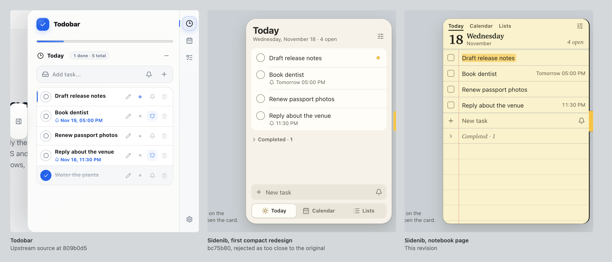
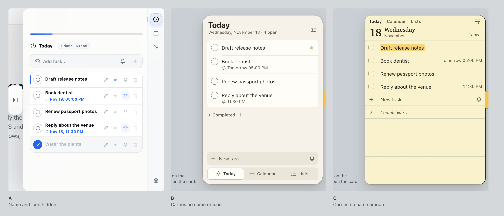

# Sidenib notebook design

Task ADIEN-172. This is the current visual and layout specification for what
is inside the Sidenib card. It replaces sections 2, 4 and 6 of the
[compact design contract](../compact/README.md) and the grouped-card layout
that contract describes. The compact contract still governs geometry, the
native window, pointer pass-through, gestures, focus and Settings contents.

Where the two documents disagree about how the card looks or how its parts are
arranged, this one wins.

## Why the layout changed

On 18 November 2026 the user compared the installed app with the original
Todobar and rejected the result: a public portfolio project needs its own
product identity, and the earlier redesign read as a reskin. The audit below
is why.

### Inherited signatures

Read from the upstream source at `809b0d5`, the v0.1.14 screenshots in
[`../compact/baseline/`](../compact/baseline/) and the compact app at
`bc75b80`.

| Area | Upstream Todobar | Compact Sidenib (rejected) | What carried over |
| --- | --- | --- | --- |
| Layout | Full-height strip, header on top, content, icon rail at the side | Card: header, one scrolling body, quick-add box, tab bar | Same stack of a title, a box you type into, and a strip of three destinations with icons |
| Navigation | Three icons in a rail (clock, calendar, list) | Three icon-and-label pills in a segmented footer | A dedicated band of three icon buttons that costs 50 px on every screen |
| Rows | Bordered white tiles in a rounded group, circle check, two text lines | White rounded group on beige, circle check, two text lines, inset hairlines | Raised white tiles on a tinted ground; circle check; the reminder on its own second line |
| Capture | A bordered box with a leading icon, a bell and a plus | A filled box with a plus and a bell | A separate input box that is not part of the list |
| Typography | Bold sans title, small bold sans rows | Bold 22 px sans title, 14 px sans rows, "date · n open" subtitle | One bold sans title over a meta string joined with dots |
| Density | 48 px rows | 44 px rows, 52 with a reminder | Three tasks fill a third of the card; the rest is an empty slab |
| Surfaces | White and grey boxes, 1 px borders, blue accent | Two-tone beige, three box styles (group, field, tab track) | Boxes inside a box |

The compact redesign changed colour, size and where the strip sits. It kept the
structure: title, boxed input, tiled rows, a band of three icon buttons.

### References and what is taken from them

- **The Peek icon** (the user's own): an ivory note, a golden tab on its right
  edge, a narrow ink edge behind the note. This is the product. The card is
  that note and the notch is that tab.
- **The original iPhone Notes** (user-supplied image): yellow paper, rules
  that run the full width and continue below the last entry, one line per
  entry with the time at the trailing end, a serif face. Taken: the material
  idea of ruled paper and the one-line entry with trailing time. Not taken:
  the leather header, the torn edge, the handwriting faces, the chevrons, the
  brown rules, the colours.
- **Modern Notes** (described, not stored): clear hierarchy and quiet system
  controls. Taken: system sans for anything you read or type, restrained
  controls. Not taken: grouped white cards, circular checks, inset
  separators, the three-pill bar.

No Apple artwork or screenshot is in the repository.

## The idea

**A notebook page pulled out from the screen edge by its golden tab.**

The closed notch is the golden tab from the icon, peeking from the edge. Open,
the tab is attached to the page it pulled out: it spans the gap between the
page and the screen edge, and the page shows the icon's narrow ink edge on
that side. The page is one sheet of pale yellow ruled paper. Tasks are written
on its lines. Nothing sits on the paper in a box.

```text
 ┌────────────────────────────────────────┐
 │ Today  Calendar  Lists              ⚙  │  index line: the three views
 │ 18  Wednesday                   4 open │  date block, bookish face
 │     November                           │
 ╞════════════════════════════════════════╡  head rule, double
 │ ☐ │ Draft release notes               │  one line per task
 ├───┼────────────────────────────────────┤
 │ ☐ │ Reply to Mara            23:30    │  reminder at the trailing end
 ├───┼────────────────────────────────────┤
 │ ＋ │ New task                      🔔  │  the next empty line is the entry
 ├───┼────────────────────────────────────┤
 │ ▾ │ Groceries                          │  a pinned list, italic label
 ├───┼────────────────────────────────────┤
 │ ☐ │ Lemons                             │
 ├───┼────────────────────────────────────┤
 │   │                                    │  empty rules to the foot
 ├───┼────────────────────────────────────┤█ ← golden tab, attached
 └───┴────────────────────────────────────┘
   ↑ margin rule: checks live in the margin
```

## Structure

| Part | Specification |
| --- | --- |
| Paper | One flat surface, `--sn-surface`. No raised groups, no sunken field, no tab track. Opaque by default. |
| Index line | 26 high, first thing on the page. Today, Calendar and Lists as words in the user's tab order; the current one is ink with an ink underline, the others secondary. A `tablist`; left and right arrows move. Settings sits at its trailing end. |
| Title line | 36 high. Today shows a date block: day number 30 px, weekday and month stacked beside it, and the open count at the trailing end. Calendar shows the month and year with previous, next and a jump-to-today button that carries today's number. Lists and Settings show a title. The title face is `--sn-font-title`. |
| Head rule | A double hairline under the header. Always drawn. |
| Margin | A 36-wide column left of a faint red rule. Checkboxes, the fold chevron of a section, the entry line's plus and a list's open count sit in it. Settings has no margin. |
| Rows | One rule per row, full width. 36 high by default. Title in system sans 14 px, up to two lines. Reminder time, event mark, note and list name are at the trailing end of the first line, not on a second line. |
| Check | 16 px square, radius 4. Done: gold fill, ink edge, ink tick; the title dims. |
| Focus priority | The title is marked with a gold highlighter stroke. It replaces the trailing dot. |
| Section label | Its own ruled line: italic title face, 13 px. Overdue, a pinned list, Completed, Backlog. |
| Entry line | The next empty line after the open tasks, in the flow of the page: a plus in the margin, the field, the reminder bell, and Task/Event in the Calendar. It sticks to the top or foot of the page when the list is longer than the page, so it is always in view. Focus thickens its rule to 2 px in the focus colour. |
| Empty page | The entry line first, then one quiet italic line. The rules continue. No centred block. |
| Foot | Rules continue at the row pitch to the bottom of the page. There is no footer bar. |
| Calendar | The grid is unchanged in behaviour. Today is a gold rounded square, the selected day an ink rounded-square ring. A six-week month leaves about 205 px of agenda at 480, against 121 before. |
| Menus, reminder picker, toast | A lighter slip of paper, radius 10, hairline edge. |
| Reminder banner | A gold slip across the page under the head rule. |
| Card | Radius 16 by default. Narrow ink edge on the docked side. |
| Notch | Closed: 12 × 48, gold. Open: 10 × 48, gold, touching the page. |

Chrome at 340 × 480: about 73 px of header and nothing else fixed. The
rejected layout spent 56 to 65 on the header, 48 on quick add and 50 on tabs.

## Tokens

[`src/design/tokens.css`](../../../src/design/tokens.css) is the source. The
copy in `../compact/tokens.css` is the rejected palette, kept for the old
prototype only.

| Role | Light | Dark |
| --- | --- | --- |
| Paper `--sn-surface` | `#FAF2CC` | `#25221B` |
| Slip `--sn-surface-raised` | `#FFFBEA` | `#322E25` |
| Tint `--sn-surface-sunken` | `#F0E6B6` | `#1A1813` |
| Ink `--sn-ink` | `#282722` | `#F3ECD8` |
| Secondary ink | `#5F5843` | `#B5AD97` |
| Tertiary ink | `#8A8263` | `#857E6B` |
| Rule `--sn-rule` | blue-grey, 30% | pale blue-grey, 13% |
| Margin rule `--sn-margin-rule` | red, 40% | red, 34% |
| Gold `--sn-accent` | `#F6C445` | `#F6C445` |
| Gold as text | `#765000` | `#F6C445` |
| Highlighter `--sn-highlight` | gold 62% | gold 30% |
| Danger | `#A3301A` | `#F0907A` |

Type: `--sn-font-title` is Charter, then Bitstream Charter, Sitka Text,
Cambria, Georgia. It is used for the date block, view titles and section
labels only. Everything a person reads at length or types is the system sans.
No font is bundled.

Gold on yellow paper has almost no contrast, so gold is never the only edge of
anything: the done check and today's date carry an ink edge, and the notch has
a dark amber hairline.

## Comparison

The same five tasks at 440 × 520 in a browser, from three sources: upstream
at `809b0d5`, the compact redesign at `bc75b80`, and this design.



With Todobar's name and icon hidden; the two Sidenib versions carry neither:



| | A, Todobar | B, compact (rejected) | C, notebook |
| --- | --- | --- | --- |
| Navigation | Icon rail at the side | Three icon pills at the foot | Three words in the head line |
| Capture | Boxed field above the list | Boxed field below the list | The next ruled line after the open tasks |
| Row | Bordered tile, two text lines, four icons | Tile in a white group, two text lines | One ruled line, time at the trailing end |
| Check | Circle | Circle | Square, in a margin column |
| Priority | Coloured dot and edge bar | Gold dot | Highlighter stroke on the title |
| Header | Logo, name, progress bar, section title | Bold sans title, dotted meta line | Date block in a serif face |
| Empty space | Blank | Blank | Ruled to the foot |
| Chrome above and below the rows | about 200 px | about 165 px | about 73 px |

B differs from A mostly in size, colour and where the strip of three sits. C
differs from both in every row of the table. C shares ruled yellow paper and
a trailing time with the original iPhone Notes, and nothing else in the
table.

Native captures: [four views](../../media/views.png),
[the other theme](native-views.png), [the closed tab](native-closed.png),
[a due reminder](native-banner.png). How they were made is in
[native verification](../../native-verification-adien-172.md).

## Rules for later work

- Do not bring back raised row groups, a boxed quick-add field, a footer tab
  bar, the three icon pills, circular checks or a second line for the
  reminder. Those are the rejected layout.
- Do not add leather, torn edges, stitched bindings, handwriting faces or any
  raster texture.
- The other eight presets recolour this layout through the same tokens. They
  do not restore the old one.
- Task text, forms and Settings controls stay in the system sans.

## Review against the brief

Checked before implementation, against the user's direction and references.

- *Same visual object as the tab*: the open tab touches the page and the page
  has the icon's ink edge. Met by geometry (open notch 10 wide, equal to the
  clearance) and one shadow.
- *One continuous paper surface, no white tiles*: there is one surface token
  on the page. Met.
- *Structural difference from Todobar*: no rail or tab band, no boxed input,
  no tiles, one-line rows, entry in the list flow, a margin column. These are
  differences of arrangement, not colour.
- *Not a literal Notes replica*: the margin rule, square checks, index line,
  date block, highlighter priority, blue-grey rules and Charter are not in
  either Notes. Ruled yellow paper with a trailing time is shared with the
  old Notes and with any legal pad; that resemblance is intended and limited
  to the material.
- *Function ahead of decoration*: every mark carries something (the margin
  holds controls, rules separate rows, the highlighter is priority). One
  thing was cut at this stage: a paper grain texture, which carried nothing.
- *Risk kept*: a serif date block and a gold closed notch are the two bold
  choices. Everything else is quiet.

This does not establish that the design is original in any legal sense. It
records which choices were made here and which were inherited.
