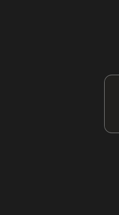
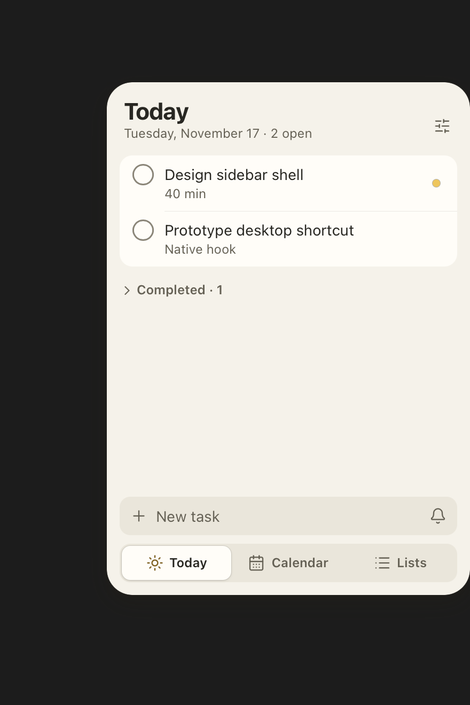

# Gray notch rectangle and see-through card (ADIEN-171)

Two faults were reported against the v0.2.0 build installed in
`/Applications` (source `cd35077`, executable SHA-256 `e05d72d9…c823ec7279`):

1. A gray rectangle stayed around the closed notch at the right screen edge.
2. With the card open, desktop text showed through the header. The task rows
   did not let anything through.

Both came from stored settings, not from the native window. This page records
how that was established on the installed build, what was changed, and what
was measured afterwards.

## Evidence on the old build

Machine: macOS 26.6.2, one built-in display, 1800 × 1169 pt at 2×, system
appearance dark. Windows were listed with `CGWindowListCopyWindowInfo` and
captured one window at a time with `screencapture -l <window id>`, which
returns that window's own pixels with their alpha and nothing behind them.

| Measured | Result |
| --- | --- |
| Closed window frame | 42 × 84 pt at the right edge. The compact default is 28 × 72. |
| Closed window pixels | 84 × 168 px. All but the two rounded left corners are one colour at alpha 107 of 255. That is the notch pill (`--sn-notch`, 42% ink) drawn 42 × 84 pt, filling the window. |
| Window shadow | None. Captures with and without the shadow option are the same size. |
| The reported rectangle | 84 × 168 px in the user's screenshot, with rounded left corners and a thin light edge: the pill and its 0.5 px outline. |
| Open window frame | 438 × 536 pt: a 400-wide card plus shadow room. The compact default is 378 × 536. |
| Open card paper | Alpha 245 of 255 (96%) across the header and body. |
| Open card rows, notch | Alpha 255. |
| Stored settings | `tabWidth: 42`, `handleHeight: 84`, `surfaceAlpha: 96`, `panelWidth: 400`, `panelRadius: 18`, `taskGap: 7`, `taskTextSize: 12.5`, `motionMs: 230`, `theme: light`, `visualStyle: codex` |

The stored values are, field for field, the defaults of the full-height app
before the compact shell (`git show a1d46bf:src/sidebarSettings.ts`). That app
wrote its whole settings object to storage the first time it ran, under the
key Sidenib still uses. The compact release kept every stored value as it was,
so on this profile it drew:

- a notch 42 pt thick and 84 pt long. The window is sized to the notch's
  pointer target, which is never smaller than the notch, so the pill covered
  the whole window. This is the gray rectangle.
- paper at 96%. The rows are separate opaque tiles, which is why text showed
  through the header and not through the rows.

So the rectangle belongs to Sidenib's own window and is the notch itself. It
is not a window background, a window shadow, stale pixels or the outline of
the pointer target.

### What was ruled out

- **Window background and shadow.** With `SIDENIB_SHELL_DEBUG=1` the corrected
  build logs the `NSWindow` state after every bounds change. On launch it
  reported `opaque=false shadow=false alpha=1 background_alpha=0` for a
  28 × 72 frame.
- **Page background.** `html`, `body` and `#root` are `background:
  transparent` under `data-runtime='tauri'` (`src/index.css`), and the pointer
  target `.sn-notch` is `background: transparent`. The alpha capture of the
  old build shows no second layer behind the pill.
- **The 100% default.** `--sn-surface-alpha` is the stored number followed by
  `%`, and the paper is `color-mix(in srgb, var(--sn-surface) <alpha>,
  transparent)`. Every preset's `--sn-surface` is an opaque colour, so 100
  gives an opaque paper. The 96% that was measured is the stored 96.

## Change

`migrateStoredSettings` in `src/sidebarSettings.ts` runs when settings are
read from storage. For a profile with no `settingsRevision`:

- `tabWidth: 42` together with `handleHeight: 84` becomes 12 and 48. If either
  differs from the old default, both are kept.
- `surfaceAlpha: 96` becomes 100, unless a backdrop image is set.
- Nothing else changes, and the profile is saved with `settingsRevision: 2`.

A profile with `settingsRevision: 2` is never converted. The old sizes and the
96% surface remain available in Advanced and hold once chosen there.

Card width, corner radius, row spacing, text size, theme and preset in an old
profile are still kept as stored. They were not part of the report.

## Automated coverage

- `tests/settings.spec.ts`: the carry-forward, the cases it leaves alone, that
  it runs once, a legacy profile through the real Settings pages, and the old
  values holding after being chosen again.
- `tests/shell.spec.ts`: the reported profile draws a 12 × 48 notch inside a
  28 × 72 transparent target and an opaque paper, and keeps its 400-wide card
  and 18 radius. This test fails with the carry-forward disabled (the notch
  measures 42 wide).

Results on this branch:

| Check | Result |
| --- | --- |
| `npm run verify`, `npm run lint`, `npm run build` | Passed |
| `node docs/design/compact/geometry.js --check` | Passed |
| `cargo test --manifest-path src-tauri/Cargo.toml` | 3 passed |
| Playwright, Chromium | 105 of 105 |
| Playwright, WebKit | 101 passed, 4 failed |

The four WebKit failures are the same four that fail on the base commit
`a3e280c`, run side by side on the same machine: `shell.spec.ts` "dragging
along the edge moves the notch without opening" and "a stored top dock is kept
and drops the same card down", and `sidebar-smoke.spec.ts` "tasks, lists,
reminders and settings work in the compact card" and "row actions are
reachable by keyboard and Escape peels one layer". They were not fixed here.
CI runs Chromium only.

A browser cannot show the native window. The tests above pin what is drawn
into it; the native result is in the next section.

## Evidence on the corrected build

Built from `38e0acf` (the source is unchanged in later commits, which only add
documentation). Executable SHA-256
`7be1cd885f238c85c35c265b6a04538ebd82d8f5d80d3c2150d38800471483b7`, ad-hoc
signature, `codesign --verify --deep --strict` passes.

Two copies were run. A verification copy, the same source built with the
identifier `io.github.adiengelbrecht.sidenib.verify`, has its own web view
storage, so profiles could be written into it without touching real data.
The installed copy in `/Applications` ran on the real profile.

Captures were either one window (`screencapture -l`) or a screen region that
lay wholly inside a plain backdrop window placed under Sidenib. Pointer and
key input was synthetic (`CGEvent`); nobody used a physical mouse. The
backdrop logged every click that reached it.

### Verification copy

| Profile and state | Result |
| --- | --- |
| Default profile, closed | Window 28 × 72 pt. The only pixels with any alpha are a 24 × 97 px box, the 12 × 48 pt pill and its 0.5 px outline. `opaque=false shadow=false background_alpha=0`.  |
| Default profile, closed, over a dark backdrop | Only the pill is visible.  |
| Default profile, open | Window 378 × 536 pt. Every pixel of the card between its rounded corners has alpha 255, header included.  |
| Open, show-through | The same region was captured over a dark backdrop covered in white text and over a light one covered in black text. Inside the card, away from the corner arcs, the two captures are identical: 0 of 577,920 pixels differ in the body and 0 of 26,680 in the strip along the header's top edge. |
| Open, pass-through | Clicks in the shadow margin left of the card, in the top-left and bottom-right corner boxes outside the arc, and in the margin above the card all reached the backdrop. A click on the card body did not. |
| Open and close by click | Eight times each way, every one changed the window between 28 × 72 and 378 × 536. Three captures taken after a close each show the pill and nothing else; while the pointer rests on the notch the pill is 2 pt thicker, as designed. |
| The reported profile, written into storage as it was found | Window 28 × 72 on launch. The profile was saved back with `tabWidth: 12`, `handleHeight: 48`, `surfaceAlpha: 100`, `settingsRevision: 2`; width 400, radius 18, spacing 7, text 12.5, `light` and `codex` were unchanged. |
| The old sizes and 80% surface saved under `settingsRevision: 2` | Window 42 × 84 on launch, and all four values were still stored afterwards. |

In an earlier scripted run several synthetic clicks sent straight after a
window capture did not toggle the notch. The run of eight above waited half a
second before each click and had no misses. The cause of the earlier misses
was not investigated; the click path is not changed by this work.

### Installed copy

Installed with `ditto` to `/Applications/Sidenib.app` after removing the
v0.2.0 copy.

| Checked | Result |
| --- | --- |
| Signature and hash | `codesign --verify --deep --strict` passes; the executable hash equals the built one, `7be1cd88…471483b7`. |
| Real profile after first launch | `tabWidth: 12`, `handleHeight: 48`, `surfaceAlpha: 100`, `settingsRevision: 2`. Every other setting as it was. |
| Tasks and lists | `sidenib.today.v1`, `sidenib.month.v1` and `sidenib.custom-lists.v1` are byte-identical to the copy taken before the work. |
| Closed window | 28 × 72 pt at the right edge, centred. Alpha only in the 24 × 97 px pill box.  |
| Login item | `~/Library/LaunchAgents/Sidenib.plist` points at `/Applications/Sidenib.app` and is byte-identical to before. |
| Todobar | `/Applications/Todobar.app` was not started or modified; its executable hash is unchanged. |

For comparison, the old build's closed window, every pixel painted:

Kept outside the repository, in
`~/Library/Application Support/Sidenib-backups/ADIEN-171-20261117/`: the
previous app (`e05d72d9…`, signature valid), the web view data as it was, and
the login item.

### Not checked natively

The Mac's screen locked repeatedly during this work, and a locked screen can
be neither captured nor driven. The following were prepared and did not run
on the corrected build:

- The open card on the installed copy with the real profile: its alpha, the
  show-through comparison and pass-through. The same checks passed on the
  verification copy, and the installed profile now stores 100%.
- Closed-state captures after a cancelled pull, a pull that opens, Escape, a
  drag along the edge and back, a switch to another app, and a restart of the
  installed copy.
- Closed pass-through beside and above the notch.
- The closed notch over a light backdrop, and the dark theme.
- The left and top docks, the hover-only notch, the reminder toast and the
  full-height option. Nothing in this change touches them.
- Windows, on any machine. Developer ID signing and notarization.

While the screen is locked, `CGWindowListCopyWindowInfo` reports the closed
window as 26 × 66 at a different position, although the app's own log gives
28 × 72. After unlocking it reported 28 × 72 at the right edge again. Window
sizes above were all read while unlocked or from the app's log.
