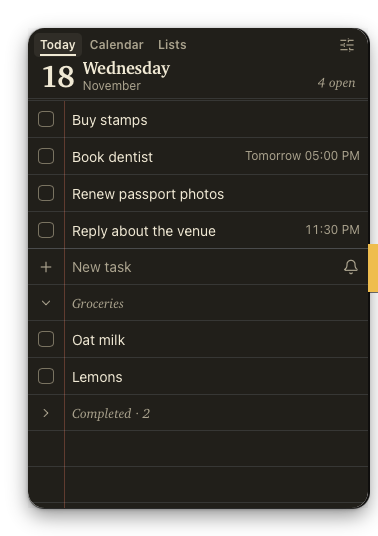
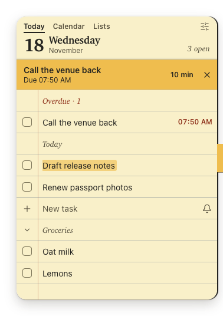

# Native verification of the notebook page (ADIEN-172)

What was run on the real macOS app for the notebook redesign, and what was
not. It also closes the native checks left open in
[ADIEN-171](native-transparency-adien-171.md).

A browser test cannot show the native window. Everything on this page was
measured on the running app; the browser results are listed separately at the
end.

## Build

| | |
| --- | --- |
| Source | `583a855` on `sidenib-original-notebook` (later commits change documentation and media only) |
| Built with | `npx tauri build --bundles app` from a clean tree |
| Installed at | `/Applications/Sidenib.app`, copied with `ditto` |
| Executable SHA-256 | `c5d088d495fe85b6385c7fdb1fab00b75e1332a0be7c4fdf9275f360a7c72a98`, equal in the build output and the installed copy |
| Signature | Ad hoc. `codesign --verify --deep --strict` passes. Not Developer ID signed, not notarized. |
| Identifier | `io.github.adiengelbrecht.sidenib`, version 0.2.0 |

`npm run tauri:build` also tries to make a `.dmg`; that step failed on this
machine (`bundle_dmg.sh`) and was not investigated. The `.app` is unaffected.

Machine: macOS 26.6.2, two displays: 3440 × 1440 at 1× and the built-in
1800 × 1169 at 2× below it. Input was synthetic (`CGEvent`); nobody used a
physical mouse. Windows were read with `CGWindowListCopyWindowInfo` and
captured one at a time with `screencapture -l`, or as a region lying wholly
inside a plain backdrop window placed under Sidenib that logged every click
reaching it. All coordinates were derived from the live window bounds.

## Installed copy, real profile

The previous app, the web view data and the login item were copied to
`~/Library/Application Support/Sidenib-backups/ADIEN-172-20261118/` first.

| Checked | Result |
| --- | --- |
| Settings after first launch | `panelWidth` 400 → 340, `panelRadius` 18 → 16, `taskRowHeight` 44 → 36, `taskGap` 7 → 0, `taskTextSize` 12.5 → 14, `motionMs` 230 → 220, `settingsRevision` 3. Unchanged: `theme: light`, `visualStyle: codex`, `launchAtLogin: true`, `dockEdge: right`, `handleY: 50`, notch 12 × 48, `surfaceAlpha: 100`. |
| In-profile backup | `sidenib.sidebar.settings.backup.rev2` holds the settings as they were (400, 18, 44, 7, 12.5, 230, revision 2). |
| Tasks and lists | `sidenib.today.v1`, `sidenib.month.v1` and `sidenib.custom-lists.v1` hash the same before the install and after both runs. |
| Login item | `~/Library/LaunchAgents/Sidenib.plist` points at `/Applications/Sidenib.app` and is byte-identical to the copy taken before. |
| Todobar | `/Applications/Todobar.app` was not started or changed; executable hash `fd47f2d0…` before and after. |
| Closed | Window 28 × 72 at the right edge, centred. Alpha only in a 12 × 48 box: the tab.  |
| Closed over a dark and a light backdrop | The gold tab and nothing else.   |
| Open | Window 378 × 536. The page shows the notebook layout at 340 wide with 36 px lines. 164,200 pixels at alpha 255: the page, its ink edge and the tab. |
| Open, show-through | The card region captured over a dark backdrop covered in white text and over a light one in black text: 0 of 132,000 pixels differ inside the card, and 0 of 21,000 in the header strip. |
| Open, pass-through | Clicks in the shadow margin left of the card, in the top-left and bottom-right corner boxes outside the arc, above the card, and in the edge gap above the tab all reached the backdrop. A click on the card body did not. |
| Click to open and close | Six cycles, every one changed the window between 28 × 72 and 378 × 536. |
| Pull 30 px | Closed again; window 28 × 72, tab only. |
| Pull 76 px | Opened. |
| Escape | Closed. The tab then shows its keyboard focus ring until focus moves, as designed. |
| Shortcut ⌥⇧S | Opened and closed. |
| Drag 150 px along the edge and back | The window followed and came back to the centre; the stored `handleY` is 50. |
| Closed pass-through | Clicks 12 px left of the pointer target, 10 px above it, 10 px below it and elsewhere on the backdrop all reached the backdrop. |
| Another app in front, then back | Closed window unchanged in both states. |
| Restart | Closed window 28 × 72, tab only. |

The whole run was done twice, on the first build (`3f7d629`,
`7075a7b7…`) and again on the final one, with the same results.

In ADIEN-171 some synthetic clicks sent straight after a window capture did
not toggle the notch. That did not happen here in twelve open and close
cycles with half a second before each click. Nothing in the click path
changed, so this is consistent with the earlier misses being a timing limit
of the automation rather than an app fault, but the cause was not isolated.

## Verification copy, seeded tasks

The same source built with the identifier
`io.github.adiengelbrecht.sidenib.verify`, so sample tasks could be written
into its own storage. The product images in the README come from this copy.

| Checked | Result |
| --- | --- |
| Add a task | Clicked the entry line, typed "Buy stamps", pressed Return. The row appeared and was in storage after quitting. |
| Complete a task | Clicked the first check; the count went from 5 to 4 open and `done` was stored. |
| Rename | Double click opened the editor on the row; Escape left the edit and the card stayed open. |
| Calendar | Opened from the index; a day chosen by click showed that day's agenda; the next-month and jump-to-today buttons were clicked. Arrow keys were sent but their effect was not asserted natively; keyboard navigation of the grid is covered in the browser. |
| Lists | Index, then a list in detail. |
| Settings | Opened from the index line; Dark applied at once and `theme: dark` was stored. |
| Dark theme | Today, Calendar and Settings drawn on the dark page. Show-through over text backdrops: 0 of 137,400 pixels differ. Closed tab captured over light and dark.  |
| Reminder, card closed | A task due two minutes earlier: the window grew to 344 × 116 for the toast, the tab carried a count badge, and the frontmost app stayed frontmost. A click in the toast's shadow margin reached the backdrop. |
| Reminder, card open | The gold slip under the head rule, the task under Overdue. Clicking the slip opened the Calendar on that day.  |
| 2× display | Opened by shortcut with the pointer on the built-in display: 378 × 536 points, 756 × 1072 pixels. |

Running this copy rewrites `~/Library/LaunchAgents/Sidenib.plist` to point at
itself, because the login item is named after the product, not the
identifier. The real file was restored from the backup after each run and
checked.

## Not checked natively

- The left and top docks, the hover-only notch and the full-height option.
- A short screen. No display shorter than 1169 points was available; the
  400-high card is covered in the browser only.
- Snooze and dismiss on the toast and the slip, list fold, pin, delete and
  the reminder picker. These have browser coverage only.
- Advanced settings pages and Reset.
- The web view following a system appearance change while running.
- VoiceOver.
- Windows and Linux, on any machine. Developer ID signing, notarization and
  the `.dmg`.

## Browser and unit results

| Check | Result |
| --- | --- |
| `npm run verify`, `npm run lint`, `npm run build` | Passed |
| `node docs/design/compact/geometry.js --check` | Passed |
| `cargo test --manifest-path src-tauri/Cargo.toml` | 3 passed |
| Playwright, Chromium | 122 of 122 |
| Playwright, WebKit | 118 passed, 4 failed |

The four WebKit failures have the names of the four that fail on `bc75b80`
and on `a3e280c`: `shell.spec.ts` "dragging along the edge moves the notch
without opening" and "a stored top dock is kept and drops the same card
down", and `sidebar-smoke.spec.ts` "tasks, lists, reminders and settings work
in the compact card" and "row actions are reachable by keyboard and Escape
peels one layer". They fail at a notch drag, at opening the card and at Tab
focus. They were not fixed here. Every test added or changed for this work
passes in WebKit. CI runs Chromium only.
